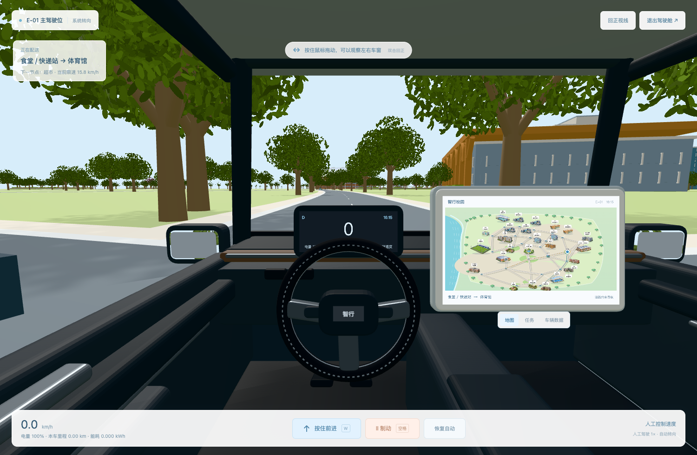

# 智行校园 · 校园配送数字孪生仿真

[在线体验](https://yun999-ccc.github.io/zhixing-campus-twin/) · [E-01 驾驶舱](https://yun999-ccc.github.io/zhixing-campus-twin/?vehicle=E-01)

三维校园与校园配送调度共享一套路网和车辆状态。保留原有订单、可信订单审计、策略对照、实测模板和三情景测算。



- 点击三维校园建筑查看信息，点击厢式配送车或顶部按钮进入 E-01 / E-02。
- 按住 W 或前进按钮控制速度，空格制动；转向沿原路网自动完成。拖动鼠标观察车窗，双击回正，Esc 退出。
- 右侧中控屏支持地图、任务、车辆数据；人工驾驶按 1× 时间运行，自动体验为 15×。
- 二维图层和全部调度数据保留在校园页。原二维页面另存于 [legacy.html](legacy.html)。

## 本地运行

在本仓库目录运行 Python 3：

```bash
python3 -m http.server 8766 --bind 127.0.0.1
```

打开 http://127.0.0.1:8766/ 。需要支持 WebGL 2 的现代浏览器；无需构建步骤、后端服务或外部 CDN。

## 文件

`index.html` 为页面入口；`cockpit/` 包含三维校园、驾驶舱和原仿真适配层；`app.js` 为配送仿真引擎；`assets/buildings/` 为原校园素材。Three.js 0.186.1 本地保存在 `cockpit/vendor/`，许可证见同目录 LICENSE。

## 模型与证据边界

校园建筑按原有图片素材进行简化重建，背面和部分细节属于推定，尚未达到逐细节一致。为避免压路，9 处建筑在所属区域内移动，二维显示位置同步；原始道路和路线计算保持不变。

订单、通行负载、能耗和碳排属于仿真模型；并非实时传感器或校园实测数据。页面提供实测 CSV 模板，等待实地校准。部分视觉素材使用生成式工具辅助；车内布局参考用户提供的内饰图片，不表示与任何汽车品牌存在关联。

项目自身未另行授予开源复用许可；Three.js 依其 MIT 许可证使用。
